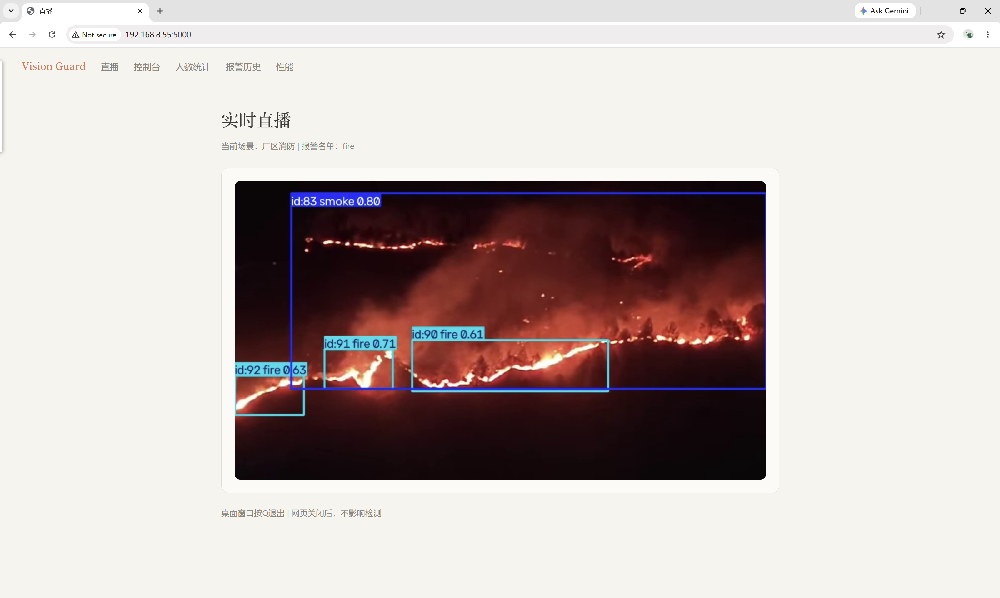
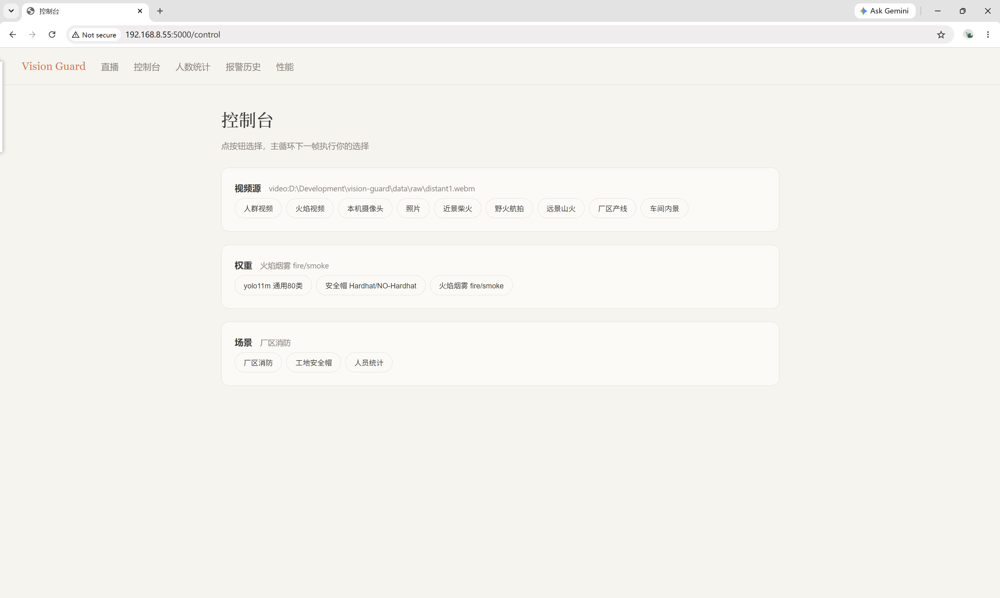
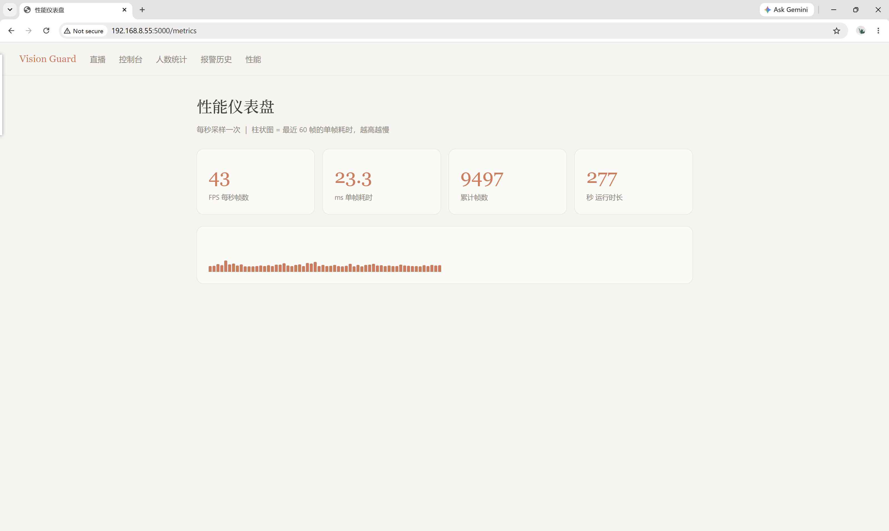
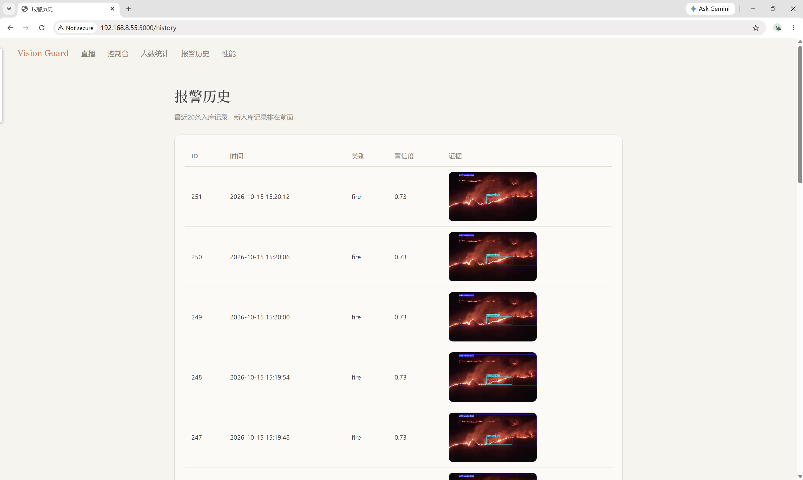
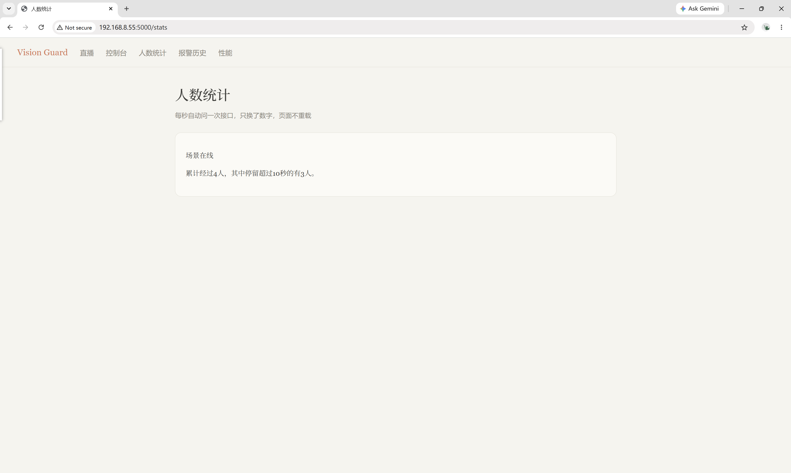

# Vision Guard — 厂区安全视觉监控平台

插件化场景的实时视觉监控平台。统一视频源管理（本地视频 / USB 摄像头 /
RTSP / 静态图）、多权重热切换、场景包（权重 + 报警名单 + 阈值 + 消抖帧数）
成套配置；Web 端五个页面：直播、人数统计、报警历史、性能仪表盘、控制台。
所有切换走"留条子"命令队列，检测线程独占摄像头与模型，网页只下单不动手。

## 界面

| 直播                             | 控制台                           |
| -------------------------------- | -------------------------------- |
|        |  |
| **性能仪表盘**                   | **报警历史**                     |
|  |  |
| **人数统计**                     |                                  |
|        |                                  |

## 快速开始

```
python -m venv .venv
.venv\Scripts\pip install -r requirements.txt
.venv\Scripts\python vg/run.py
```

浏览器打开 http://localhost:5000 （端口在 vg/settings.py 的 WEB_PORT）。
权重不入仓库（.gitignore），火焰烟雾权重可自行下载：

```
curl.exe -L -o weights/fire_smoke_yolov8n.pt https://hf-mirror.com/rabahdev/fire-smoke-yolov8n/resolve/main/best.pt
```

## 运行环境

Python 3.13 / torch 2.14.0+cu130 / ultralytics 8.4.153 / OpenCV(contrib) /
Flask + Jinja2 / SQLite；本机硬件 RTX 4060laptop 8GB。

## 架构

| 文件           | 职责                                                         |
| -------------- | ------------------------------------------------------------ |
| vg/run.py      | 主循环：读帧→检测→场景记账→报警入库→挂画板；每帧开头执行所有"条子" |
| vg/detector.py | YOLO 封装：detect / detect_track，置信度阈值由调用方递入     |
| vg/source.py   | Source 类：video / camera / rtsp / image 四源统一为一个 read() |
| vg/scene.py    | Scene 类：跟踪点名册(set/dict)、N 帧消抖、累计人数与停留统计 |
| vg/metrics.py  | Perf 类：60 帧滑动窗口记每帧耗时，算 FPS / 平均毫秒          |
| vg/web.py      | Flask：5 个页面路由 + /api 数据口 + 三个"条子口"(set_source/set_model/set_scene) |
| vg/settings.py | 配置：SOURCES / MODELS / SCENES 三张菜单 + 路径锚定          |
| vg/alarm.py    | SQLite 报警入库、证据图管理                                  |
| vg/eval.py     | 选型评测：权重×视频全组合扫描，自动写 docs 报告与结论        |
| vg/qc_video.py | 素材质检：抽样检测计数，新视频入库前的门槛                   |

三个关键设计：

1. **留条子命令队列**：网页线程只写 `LATEST["pending_*"]`，主循环每帧开头取走并
   清空后执行。摄像头与模型永远只被一个线程碰，规避多线程竞态。
2. **场景包成套切换**：权重、报警名单、阈值、消抖帧数打包在 SCENES 菜单里一起换，
   杜绝"换了眼睛没换名单"的错位（安全帽权重 + 消防名单 = 永远不报警）。
3. **两道防线**：报警名单过滤"类别误检"，消抖帧数过滤"偶发误报"。误检 ≠ 误报。

## 实测数据

### 选型评测（conf 0.3，每 10 帧抽 1，2026-10-14）

| 权重        | 视频     | 命中/抽样 | 命中率 | 平均置信度 | 平均单帧ms |
| ----------- | -------- | --------- | ------ | ---------- | ---------- |
| 火焰烟雾v8n | 近景柴火 | 27/27     | 100%   | 0.62       | 67.2*      |
| 火焰烟雾v8n | 野火航拍 | 4/16      | 25%    | 0.43       | 7.3        |
| 火焰烟雾v8n | 弱火困难 | 6/54      | 11%    | 0.34       | 6.7        |
| 火焰烟雾v8n | 人群对照 | 83/1770   | 5%     | 0.46       | 6.6        |
| 火焰烟雾v8n | 远景山火 | 20/20     | 100%   | 0.51       | 7.7        |
| 火焰烟雾v8n | 极远景烟 | 2/105     | 2%     | 0.33       | 8.6        |
| 火焰烟雾v8n | 厂区产线 | 46/436    | 11%    | 0.45       | 5.7        |
| 火焰烟雾v8n | 车间内景 | 3/52      | 6%     | 0.43       | 5.5        |
| 通用yolo11m | 近景柴火 | 18/27     | 67%    | 0.52       | 16.0       |
| 通用yolo11m | 野火航拍 | 0/16      | 0%     | 0.0        | 12.1       |
| 通用yolo11m | 弱火困难 | 9/54      | 17%    | 0.5        | 13.5       |
| 通用yolo11m | 人群对照 | 1716/1770 | 97%    | 0.68       | 11.5       |
| 通用yolo11m | 远景山火 | 0/20      | 0%     | 0.0        | 11.3       |
| 通用yolo11m | 极远景烟 | 1/105     | 1%     | 0.73       | 12.8       |
| 通用yolo11m | 厂区产线 | 239/436   | 55%    | 0.65       | 10.2       |
| 通用yolo11m | 车间内景 | 49/52     | 94%    | 0.66       | 12.2       |

近景柴火行 ms 偏高因该视频每帧火框密集（27 帧全命中）且含首帧暖机；
其余行 v8n 为 5.5–8.6ms，yolo11m 为 10.2–16.0ms。

### 实时性能（仪表盘实测，2026-09-30）

通用 yolo11m + 人群视频 + ByteTrack：37–44 FPS，单帧 22–27ms；
窗口 FPS 高于全程平均（开机首帧暖机拖低全程值），故仪表盘采用 60 帧滑动窗口。

### 素材质检（qc_video.py，conf 0.3）

| 视频                    | 命中率                                   | 说明                                    |
| ----------------------- | ---------------------------------------- | --------------------------------------- |
| 近景柴火 fireclose1.ogv | 9/9                                      | 消防近景主力                            |
| 远景山火 distant1.webm  | 20/20                                    | fire 118 框 + smoke 20 框，消防远景主力 |
| 车间内景 factory2.ogv   | 49/52                                    | person 62 框，人员场景主力              |
| 厂区产线 factory1.webm  | 239/436                                  | person 648 框 + COCO 杂类误检谱         |
| 野火航拍 wildfire1.webm | 4/16                                     | 弱火替补                                |
| 弱火困难 fire.mp4       | 0/18（conf 0.1 下 9/18，最高 conf 0.22） | 困难样本，阈值敏感性证据                |
| 极远景烟 distant2.webm  | 2/105                                    | 能力边界样本                            |

## 遇到的问题与改进

1. **自训模型 mAP 崩塌**：6 张自标图微调后连基础类别都认不出（灾难性遗忘 +
   域偏移）。改进：放弃自训路线，改用社区预训练权重 + 质检流水线把关素材。
2. **OpenCV 窗口不弹 / q 退不出**：x-anylabeling 带入的 headless 版覆盖了 GUI 版。
   改进：重装 opencv-contrib-python，并在依赖说明中标注冲突。
3. **USB 摄像头 0 帧**：MSMF 后端读不到。改进：显式指定 CAP_DSHOW。
4. **RTSP 画面花屏断流**：UDP 丢包。改进：设置
   OPENCV_FFMPEG_CAPTURE_OPTIONS=rtsp_transport;tcp 走 TCP。
5. **网页"不报错但不加载"**：MJPEG 直播流不结束，占满浏览器同源 6 连接上限，
   且空等线程不 yield 不 sleep 成为僵尸。改进：空等 sleep(0.05) + 60 秒收线归还连接。
6. **模板数据不显示且不报错**：Jinja 对未定义名字静默（空串/空循环/假），
   render_template 漏递参数只会走错分支。改进：建立"模板变量 ↔ 每个 return 分支
   参数"逐一核对的自查习惯。
7. **换源/换权崩溃风险**：网页线程与检测线程抢同一个 cap/model。改进：留条子
   命令队列，换动作只由检测线程在两帧之间执行。
8. **换权重显存峰值**：直接赋值时新旧模型同在 8GB 显存。改进：先 del 旧模型再 load。
9. **火焰视频"识别不到"**：实为用 COCO 权重（无 fire 类）去检火。改进：先验权重
   类别表（.names 验尸），再谈素材；并建立 qc 质检门槛（命中率 <20% 不入库）。
10. **消防误报偏高**：火焰权重在人群视频误检中 smoke 84 次、fire 4 次。改进：
    消防报警名单收敛为 ["fire"]，smoke 仅显示不报警，误报面砍 95%。

## 可靠性设计

- **名单 = 误检过滤器**：通用模型在厂区检出的 hot dog(127)/suitcase(144) 不在报警
  名单内，不触发任何报警。
- **消抖 = 误报过滤器**：连续 N 帧命中才报警（消防 3 帧、人员 5 帧），挡偶发误检。
- **阈值进场景包**：conf 0.3（消防，保召回）与 0.4（人员，保干净）按场景分级，
  不做全局一刀切；依据是弱火样本 0.3 下 11%、0.1 下 50% 的阈值敏感性实测。

## 文档与报告

- docs/eval_report_1.md —— 评测全表 + 脚本自动结论（最新一次运行产物）
- docs/eval_report.md —— 早期一次运行的表（无结论段，留作对照）
- docs/eval_report_1的报告分析.md —— 本人写的的选型/阈值/误报取舍分析

## 素材与权重来源

- 权重：Ultralytics 官方 yolo11m；hf-mirror.com 社区权重
  rabahdev/fire-smoke-yolov8n（类别 {0: smoke, 1: fire}）、安全帽权重
- 视频：Wikimedia Commons（CC 授权）——Industrial production in a chocolate
  factory、ISD workshop 1、Mountain Forest Fire in Pauri Garhwal、
  Pyrocumulus 2022 Czechia、Emigrant Fire、Fire burning
- 困难样本与对照样本：data/raw/ 自建归档